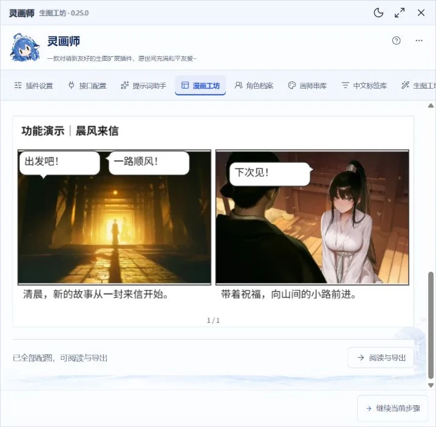

# 灵画师

一款对萌新友好的生图扩展插件，愿世间充满和平友爱~

**作者：小波** · **许可：[灵画师个人使用与署名许可](LICENSE)**

**当前前端版本：0.25.0** · **可选服务器组件：0.21.0，存储协议 2**

灵画师是 SillyTavern 的图片生成扩展。可以在生图工坊手动绘图，也可以识别聊天里的提示词，在原位置显示图片；支持 NovelAI、OpenAI 兼容、ComfyUI、SDWebUI 四种模式，以及角色档案、提示词编辑、图片历史版本和九套人物主题。

> **2026-10-23 文档更新**：本仓库当前安装代码仍为 10 月 19 日发布的 0.25.0。近期完成测试的漫画工坊、图文阅读、助手底层提示词编辑等更新，已整理为 [待发布功能说明与图文教程](docs/preview/README.md)。这些功能尚未随本次文档提交发布，更新本仓库不会立即获得新版界面。下方原有教程继续对应当前安装版。

## 新版功能与图文教程

先看 [版本适用范围和更新总览](docs/preview/README.md)，再按目标选择教程：

| 想完成的事 | 待发布新版图文教程 |
| --- | --- |
| 第一次使用、选服务、区分三种配置、生成第一张图 | [从安装到第一张图](docs/preview/first-run.md) |
| 使用酒馆模型与预设、自定义底层规则、修复分析失败 | [提示词助手与聊天配图](docs/preview/assistant.md) |
| 从剧情制作分镜、配图、拖动气泡、管理章节和导出漫画 | [漫画工坊完整流程](docs/preview/comic.md) |
| 恢复草稿与任务、切换图片版本、阅读导出、换设备 | [草稿、图片与备份](docs/preview/recovery-export.md) |
| 手机布局、独立 API 转发、网络存储排错、本地反推与超分 | [手机使用与可选组件](docs/preview/mobile-components.md) |

以下是待发布测试版的漫画排版实机截图。对白由插件叠加绘制，修改对白不需要重新生图；完整操作见 [漫画教程](docs/preview/comic.md)。



## 安装与第一张图

需要 SillyTavern **1.12.13 或更高版本**。在酒馆「扩展 → 安装扩展」中填写：

```text
https://github.com/ibome/ai-brush-hug-st
```

也提供 **TauriTavern v2.3.0** 宿主适配。安装包需允许第三方扩展；公开 TestFlight 默认策略、存图位置和代理差异见 [TauriTavern 使用说明](docs/tauritavern.md)。

刷新酒馆，从扩展设置打开「灵画师」，或点击人物悬浮图标再选「设置」。仓库包含可直接安装的 `manifest.json` 和 `dist/`，普通用户无需编译。

1. 在「插件设置」选择生图模式。
2. 到「接口配置」填写自己的接口和秘钥，选择模型，测试连接。
3. 到「生图工坊」填写提示词，先以一张、小尺寸测试。
4. 点击「生成图像」，结果会进入「绘图管理」。
5. 用「另存为」保存参数预设，便于下次使用。

完整步骤见 [新手入门](docs/quickstart.md)。管理员安装、服务器组件和更新步骤见 [安装与更新](docs/install.md)。

## 使用教程

本表对应 GitHub 当前安装版；新增功能请看上方明确标注的待发布教程。

| 想完成的事 | 教程 |
| --- | --- |
| 第一次安装、配置并画出第一张图 | [新手入门](docs/quickstart.md) |
| 在 TauriTavern 安装、存图、使用代理和排查问题 | [TauriTavern](docs/tauritavern.md) |
| 插件开关、主题、悬浮球、排队与并发、自动生图、存储与清理 | [插件设置](docs/settings.md) |
| 配置四种接口、模型、秘钥、命名接口和参数预设 | [接口配置](docs/interfaces.md) |
| 文生图、参考图、图生图、蒙版重绘、Vibe、组合生图和画风探索 | [生图工坊与高级生图](docs/generation.md) |
| 聊天标签、再画一张、提示词助手、独立文字 API、智能配图 | [聊天联动与提示词助手](docs/chat-assistant.md) |
| 多角色档案、AI 创建档案、服装、画师串、中文标签和可视化编辑 | [角色与提示词素材库](docs/libraries.md) |
| 筛图、参数回填、单图编辑、历史版本、服务器存图和任务恢复 | [绘图管理、存储与任务](docs/gallery-tasks.md) |
| NovelAI 高清放大、细节增强和导演工具 | [NovelAI 图片增强](docs/novelai-processing.md) |
| SDWebUI 模型、LoRA、高清修复、图片放大和进度 | [SDWebUI 原生接入](docs/sdwebui.md) |
| 备份、换设备、分享包、加密秘钥和恢复 | [备份与恢复](docs/backup.md) |
| 内置账号存图、可选增强组件、下载与安装 | [扩展组件](docs/components.md) |
| 秘钥、权限、模型列表、跨域和任务状态问题 | [常见问题](docs/faq.md) |
| 网络、存储与缓存检测、保存失败和卡顿日志 | [调试工具](docs/debug-tools.md) |
| 其他扩展调用灵画师生图 | [扩展 API v1](docs/extension-api.md) · [客户端示例](examples/linghuashi-client.js) |

## 四种生图模式

| 模式 | 连接方式 | 主要能力 |
| --- | --- | --- |
| NovelAI | 官方 `pst-` 或已适配的第三方秘钥；第三方地址可选 | 独立正负提示词、画师、模型与预设、Vibe、人物参考、图生图、重绘、图片增强 |
| OpenAI 兼容 | 接口地址、Key、图片模型 | 模型列表、通用图片参数、`nai-diffusion` 独立负面词；显式开启后可尝试图片编辑 |
| ComfyUI | ComfyUI 服务地址、API 工作流 | 参数节点映射、模板、LoRA、底图与蒙版、节点进度和结果读取 |
| SDWebUI | 启用原生 API 的服务，无鉴权、Basic 或 Bearer | Checkpoint、VAE、LoRA、文生图、图生图、局部重绘、高清修复、extras 放大 |

具体能力由模型、服务权限和工作流决定。**获取到模型列表或测试连接成功，不代表已经验证生图权限。** 按 [接口教程](docs/interfaces.md) 完成一次实际生图后，再保存常用配置。

## 聊天里使用

让角色在回复中输出：

```text
她站在庭院里。image###1girl, garden, soft light, anime illustration###
```

默认开启「自动生图」和「在聊天中显示图片」，默认关闭「生成前确认提示词」。新完成的角色回复中，符合格式的提示词会进入队列，图片显示在原提示词位置。旧消息不会自动补画，可点击「给这条配图」手动处理。

没有提示词标签也能使用「智能配图」：文字模型先分析画面并准备草稿，确认后再生成图片。自动准备提示词与准备后自动生图是两个独立开关，默认关闭。完整设置见 [聊天联动与提示词助手](docs/chat-assistant.md)。

## 存储与服务器组件

图片可保存在浏览器，或当前登录账号的酒馆服务器目录。「酒馆服务器」不是下载到电脑；浏览器图片也不会自动同步到其他设备。

**普通酒馆服务器存图无需额外组件。** 选择「插件设置 → 图片存储 → 酒馆服务器」即可通过酒馆自带接口保存原图、缩略图、参数和参考素材。文件保存在当前账号的 `user/images/linghuashi/`、`user/images/linghuashi-thumbnails/` 和 `user/files/linghuashi-*`，同账号换设备可读取作品与参数。

未安装增强组件时，任务记录与待保存响应保留在当前浏览器，刷新后可恢复；多设备同时生图的执行锁和关闭页面后的清理需要可选 `linghuashi-storage` 组件。已有组件和旧图片继续兼容，后来安装组件也不会隐藏先前的内置存储图片或当前浏览器任务。

侧边栏「扩展组件」可查看状态、下载组件、展开安装步骤。服务器组件需管理员放入酒馆 `plugins/`，启用 `enableServerPlugins: true` 并重启。0.22.0 的组件包内部仍为 0.21.0／协议 2，已安装兼容组件无需更新。详见 [扩展组件](docs/components.md)。

## 更新与版本记录

先等待当前任务结束并导出个人备份，再到「更新日志」顶部的「版本与更新」中点击「立即更新」。完成后手动刷新酒馆生效。服务器组件发生变化时，管理员还需更新组件并重启酒馆。

- [2026-10-23 待发布功能清单](docs/preview/README.md)：近期功能、图文操作、版本差异与测试边界；本次仅同步文档。
- 界面侧边栏「更新日志」：离线查看按版本折叠的完整记录。
- 「更新日志 → 版本与更新」：检查发布版本及服务器组件、查看发布说明、点击更新或下载。
- GitHub 发布新版后，扩展列表显示版本标记，当前主题的透明 Q 版人物喊「插件更新啦！」，点击进入更新页。同一版本关闭后不再反复提醒，版本标记仍保留。
- 后台成功检查缓存一小时，查询失败不弹窗；手动「检查版本」可立即重新查询。Git 安装支持酒馆原生更新，ZIP 安装可下载前端包手动覆盖。
- [0.25.0 发行说明](docs/releases/v0.25.0.md)：TauriTavern v2.3.0 适配、本机存图、任务恢复、模型查询与专项教程；已完成自动化和浏览器回归，尚未完成真机验证。
- [0.24.2 发行说明](docs/releases/v0.24.2.md)：手机功能栏保留滚动位置、旧浏览器独立 API 连接修复与助手专用网络检测。
- [0.24.1 发行说明](docs/releases/v0.24.1.md)：修复手机助手页面闪动、滚动和选模中断，新增可搜索模型列表。
- [0.24.0 发行说明](docs/releases/v0.24.0.md)：普通 HTTP 兼容、侧边栏调试工具、存储诊断与图库写入优化。
- [0.23.3 发行说明](docs/releases/v0.23.3.md)：修正 NovelAI 官方订阅检测、不透明辅助请求与手机本机地址误报。
- [0.23.2 发行说明](docs/releases/v0.23.2.md)：连接失败时检测当前设备网络，复制脱敏日志反馈。
- [0.23.1 发行说明](docs/releases/v0.23.1.md)：修复浏览器设置缓存空间不足时界面无法打开和配置同步中断。
- [0.23.0 发行说明](docs/releases/v0.23.0.md)：新内容使用许可与完整版权声明。
- [0.22.2 发行说明](docs/releases/v0.22.2.md)：修复流式回复期间聊天正文与配图反复闪动。
- [0.22.1 发行说明](docs/releases/v0.22.1.md)：打开插件时提示新版，更新日志自动展开新版动态与更新入口。
- [0.22.0 发行说明](docs/releases/v0.22.0.md)：内置账号存图与可选扩展组件。
- [0.21.4 发行说明](docs/releases/v0.21.4.md)：主题 Q 版提醒、更新面板移动与点击更新。
- [0.21.3 发行说明](docs/releases/v0.21.3.md)：扩展列表更新提醒。
- [0.21.2 发行说明](docs/releases/v0.21.2.md)：聊天配图同步的弹窗修复。
- [0.21.1 发行说明](docs/releases/v0.21.1.md)：从 GitHub 0.11.1 升级的主要变化。
- [完整更新日志](CHANGELOG.md)：逐版本记录。
- [Releases](https://github.com/ibome/ai-brush-hug-st/releases)：安装包与 SHA256 校验文件。

## 交流与反馈

**NovelAi&ComfyUI\*灵画师交流群**

QQ 群号：**1076122953**，也可以扫描下方二维码加入。


遇到问题或有功能建议，可以前往 [GitHub Issues](https://github.com/ibome/ai-brush-hug-st/issues) 反馈。请附上插件版本、使用的接口模式、复现步骤及相关截图，截图和日志请遮住秘钥等私人信息。

## 许可协议

从 0.23.0 起，作者有权授权的原创新增及修改内容采用 [灵画师个人使用与署名许可](LICENSE)。允许免费安装、自建酒馆部署、备份及自用修改；这些新内容未经书面授权不得搬运分发、改名发布、出售或冒充原作。

**旧版 BSD 权利继续有效。** 0.22.2 及更早版本和沿用的原有 BSD 内容不被追溯收回授权，旧许可见 [BSD 2-Clause 历史许可](LICENSES/BSD-2-Clause-legacy.txt)。第三方组件保持各自许可，见 [第三方声明](THIRD-PARTY-NOTICES.txt)。

公开仓库继续提供源码，新内容使用许可不是 OSI 开源许可证。完整使用边界见 [使用与署名说明](docs/usage-license.md)。
