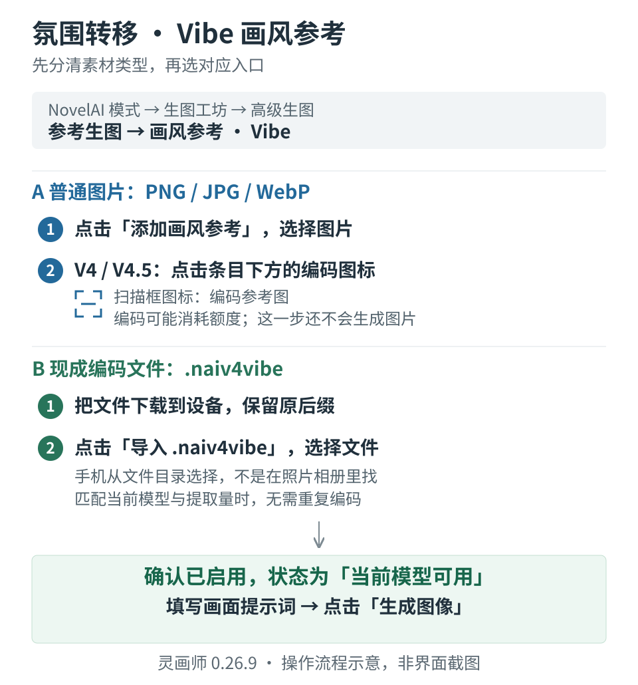

# 氛围转移新手教程 · Vibe 画风参考

[返回教程目录](../README.md#使用教程) · [生图工坊与高级生图](generation.md) · [接口配置](interfaces.md)

适用：灵画师 **0.26.9** 的 **NovelAI 模式**。核对日期：2026-11-12。插件里显示的名称是「画风参考 · Vibe」，大家常说的“氛围转移”就是它。

想让新画面参考一张图的画风、配色或视觉感觉，可以用 Vibe。人物、动作和场景仍要在提示词中描述；参考图也可能带入构图或物体，不保证只提取画风或固定人物长相。

## 先看你手里是什么

| 手里的素材 | 点击哪个按钮 | 接下来怎么做 |
| --- | --- | --- |
| 普通 PNG、JPG、WebP 图片 | **添加画风参考** | 上传图片，V4／V4.5 再点编码按钮 |
| 别人分享或自己导出的 `.naiv4vibe` 文件 | **导入 .naiv4vibe** | 导入文件，检查是否显示「当前模型可用」 |
| 之前保存过的 Vibe 素材 | 展开 **Vibe 素材库**，点击条目旁的加号 | 载入后检查模型与信息提取量 |

这里的“编码”是把参考图转换成图片模型需要的参考数据。**不用自己写代码，也不用把编码粘贴到提示词框。**



这是一张操作流程示意图，不是模型效果对比图。手机上可点开图片放大，具体操作见下面两条路线。

## 第一步：找到功能入口

1. 在「插件设置」把生图模式选为 **NovelAI**。
2. 在「接口配置」填好该模式的接口与秘钥，选择模型；先确认普通文生图能成功。
3. 打开「生图工坊」，找到 **「高级生图」** 区域。
4. 生成方式点 **「参考生图」**。
5. 「参考用途」选择 **「画风参考 · Vibe」**。

本教程重点演示 V4／V4.5。插件当前识别的型号包括 `nai-diffusion-4-full`、`nai-diffusion-4-curated-preview`、`nai-diffusion-4-5-full` 和 `nai-diffusion-4-5-curated`。

使用 V3／Furry V3 时，插件直接使用参考图片，不显示单独的编码按钮。其他型号以当前界面开放的能力为准。

**OpenAI 兼容模式即使选了名字包含 `nai-diffusion` 的模型，也不会显示这套 NovelAI Vibe 控件。** 需要使用插件的 NovelAI 模式，并由所选服务支持相应能力。能普通生图不等于服务一定支持 Vibe 编码或参考生图。

## 路线 A：只有普通图片，上传后自己编码

1. 点击 **「添加画风参考」**，选择 PNG、JPG 或 WebP 图片。
2. 确认下方出现参考条目，名称左侧的启用框已勾选。
3. 先用新上传图片的默认值：**参考强度 0.6，信息提取量 1**。这是试用起点，可以再根据效果调整。
4. 在条目下方找到 **扫描框形状的编码图标**。电脑鼠标悬停会提示「编码参考图（可能消耗额度）」；手机直接点这个图标。
5. 等待处理完成，条目状态应从「需编码当前模型与提取量」变成 **「当前模型可用」**。
6. 在工坊填写你想生成的画面提示词，选择尺寸与张数，点击 **「生成图像」**。

编码成功只代表参考数据准备好了，**还要点击「生成图像」才会出图**。编码与绘图是两个请求，均可能按所选服务的规则计费。

例如参考图是喜欢的水彩插画，希望画一个在花园读书的人物，正向提示词可以先试：

```text
1girl, reading a book, sitting on a bench, garden, flowers, daylight
```

提示词负责说明要画什么，参考素材参与决定视觉效果；示例不保证得到某一种固定画风。

## 路线 B：已经有 .naiv4vibe 编码文件

1. 先将收到的文件下载到设备，保留 **`.naiv4vibe`** 后缀。
2. 在「参考生图 → 画风参考 · Vibe」点击 **「导入 .naiv4vibe」**。
3. 从文件选择器选中这个文件。此入口选择的是文件，不是把编码内容复制到输入框。
4. 导入后确认该条目启用，先保留文件带入的参考强度与信息提取量。
5. 检查条目状态。显示 **「当前模型可用」** 时，可以直接填提示词生成，无需为了使用同一份匹配编码再点一次编码。

如果仍显示「需编码当前模型与提取量」，先核对当前模型和文件支持的模型，以及对应的信息提取量。V4、V4.5、Full、Curated 的编码分别保存，不能仅凭文件里“有编码”就认定当前型号一定可用。

文件里包含原图时，可以针对当前支持的模型重新编码。**只有编码、没有原图的文件，不能在插件里凭空重新编码**；可改用与现有编码匹配的模型和提取量，或请分享者提供对应编码／原图。

### 手机选不到文件怎么办

- iPhone：先把收到的文件保存到「文件」App，再在文件选择器中浏览对应目录；不要只在照片相册中找。
- Android：先下载文件，再到文件选择器的「下载内容」或实际保存目录中选择。
- 收到的是 ZIP 时，先解压，选择里面的 `.naiv4vibe`。
- 不要把 JPG、PNG、TXT 或 ZIP 直接改名为 `.naiv4vibe`，改后缀不会生成有效编码。

当前入口支持符合格式的单个 `.naiv4vibe` 文件，大小不超过 24 MB。不提供粘贴 Base64 的输入框，也不直接导入 `.naiv4vibeBundle` 整包。图片内嵌的编码元数据不会通过「添加画风参考」自动恢复；请提供单独的 `.naiv4vibe` 文件。

## 参考强度、信息提取量和编码的关系

| 项目 | 通俗解释 | 新手怎么调 | 是否需要重新编码 |
| --- | --- | --- | --- |
| 参考强度 | 生成时让参考素材发挥多大影响；越接近 1，参考通常越强 | 新上传图片先试默认 0.6；太像参考、忽略提示词时先降低它 | 单独修改它不需要 |
| 信息提取量 | 编码时从原图保留多少、哪些视觉信息；不是清晰度或相似度百分比 | 新上传图片先保留默认 1；导入编码时先保持文件带入值 | V4／V4.5 修改后需匹配该值的编码 |
| 当前模型 | 实际使用哪一款生图模型 | 编码前先选定，不要把 Full、Curated 当成同一款 | 换型号后需匹配该型号的编码 |
| 启用框 | 这条参考是否参与本次绘图 | 只勾选本次需要的素材 | 不需要 |

对 V4／V4.5，降低信息提取量并不等于“只保留画风、去掉人物”。官方说明它会先丢失纹理等高频信息，因此更低的值可能留下较多构图、较少风格。想减弱参考干扰时，建议先试降低参考强度，再考虑修改信息提取量。

插件当前为每条参考的每种支持模型保存一份编码。针对同一模型用新的信息提取量重新编码，会替换该模型原有的一份；需要保留旧版本时，先导出文件或另存素材。复杂文件中同一模型含多组提取量时，当前导入会保留首先读到的一组，不提供组内切换菜单。

## 多张参考怎么用

1. 再次点击「添加画风参考」或「导入 .naiv4vibe」，添加下一份素材。
2. 分别设置是否启用、参考强度和信息提取量；V4／V4.5 要逐条确认「当前模型可用」。
3. 保持勾选 **「总参考强度超过 1 时自动归一化」**。
4. 先用少量参考测试，再逐个加入，方便看出是哪张图影响了结果。

灵画师 0.26.9 同时最多载入 **8 份 Vibe**，这是插件当前上限。归一化开启时，两份强度都设为 0.8，总和为 1.6，提交时各自按比例变成 0.5；总和不超过 1 时不会被强行放大到 1。

## 保存、导出和换设备

### 保存到 Vibe 素材库

1. 给当前参考起一个容易辨认的名称，例如「水彩参考 · V4.5 Full · 提取量 1」。
2. 点击参考条目下方的 **书签加号图标**，提示为「保存当前名称、强度和编码到素材库」。
3. 填写分类并保存。
4. 下次展开「Vibe 素材库」，按名称、分类或模型搜索，点击条目旁的 **加号** 载入。
5. 载入后再核对启用状态、当前模型和信息提取量。后来重新编码或调整默认值时，需要再次保存，素材库中的旧条目不会因此自动更新。

### 导出编码给自己或别人复用

点击参考条目下方的 **下载图标**，提示为「导出 .naiv4vibe」。至少已有一份编码才能导出。文件可带上已有的原图和受支持的模型编码，下次用「导入 .naiv4vibe」载入。

用已匹配的编码可以省去重复编码这一步，后续绘图仍按服务规则计费。编码文件不包含插件的 API 秘钥，但可能包含原始参考图；分享前确认这是你希望分享的素材。

换设备时，单份参考可用 `.naiv4vibe` 转移；批量搬迁配置与引用素材请看 [备份与恢复](backup.md)。浏览器存储中的素材不会仅因更换设备而自动出现。

## 常见问题

| 现象或提示 | 先检查什么 | 怎么处理 |
| --- | --- | --- |
| 找不到「画风参考 · Vibe」 | 生图模式、当前模型、生成方式 | 使用 NovelAI 模式，选择受支持模型，再点「参考生图」 |
| 已上传图片，仍提示需要编码 | 当前条目只保存了图片 | V4／V4.5 点击条目下方的扫描框编码图标，等状态变为「当前模型可用」 |
| 导入编码后仍提示缺少当前模型与提取量的编码 | 文件是否有当前型号及对应提取量 | 使用匹配型号与提取量；有原图时可重新编码，没有原图时请分享者提供 |
| 没有编码按钮 | 是否使用 V3／Furry V3 | 这两类模型直接使用原图，不显示单独编码按钮 |
| 编码按钮是灰色 | 模型是否受支持、参考是否含原图 | 含纯编码的文件可能没有原图；使用已有匹配编码，或添加原图后再编码 |
| 「此接口不支持 Vibe 编码」或 HTTP 404 | 当前服务是否实现编码接口 | 可导入匹配的现成编码，或换支持编码的服务；导入不保证该服务也支持参考生图 |
| 「Vibe 编码被拒绝（HTTP …）」 | 秘钥、权限、额度以及服务支持情况 | 核对当前 NovelAI 连接，结合 HTTP 状态与服务说明排查，不要只看普通生图是否成功 |
| 「接口未返回有效的 Vibe 编码」 | 服务是否返回了正确的编码数据 | 向服务提供方确认支持，不能把普通图片或错误页当作编码 |
| 「Vibe 文件不是有效 JSON」或「文件没有可用编码」 | 文件是否完整、是否真实编码文件 | 重新下载原始 `.naiv4vibe`；不要改后缀或粘贴聊天里的不完整片段 |
| 图片不够像参考，或太像而不听提示词 | 条目是否启用、强度是否合适、文字画风是否冲突 | 一次只调整一个参数；先调整参考强度，必要时精简冲突的画师串和风格词 |
| 同样参考却换了人物、姿势或场景 | 是否把 Vibe 当作人物或构图锁定 | 用提示词描述目标；希望参考人物时可查看「人物参考 · V4.5」，希望从底图修改时用图生图 |

编码网络连接失败时，可到「调试工具」检查当前设备网络，按 [调试教程](debug-tools.md) 收集日志；这类检查不能证明服务支持编码。反馈时注明插件版本、NovelAI 模型、服务名称、图片上传还是文件导入、提示的完整错误，并遮住秘钥。

## 资料与适用范围

- [NovelAI 官方 Vibe Transfer 说明](https://docs.novelai.net/en/image/vibetransfer/)：参数含义、编码与费用机制。
- [插件参考界面](../src/ui/advanced.js)：本教程使用的按钮名称、导入入口和素材库操作。
- [插件参考能力与文件解析](../src/advanced-generation.js)：当前支持型号、匹配规则和文件限制。

官方网页可能提供更多参考数量、编码导出形式或新模型；本教程按灵画师 0.26.9 已实现的入口说明，不把官网全部功能视为插件已支持。文中示意图用于讲解操作，本次编写未提交付费编码或绘图请求。
