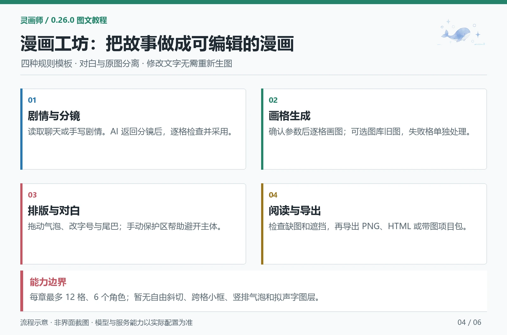

# 漫画工坊完整流程

[教程目录](README.md) · [提示词助手](assistant.md) · [备份与恢复](recovery-export.md)

> 适用于 0.26.0。配图为操作流程示意；完整控件参考见 [漫画工坊](../comic-workshop.md)。



## 先认识四个步骤

```text
剧情与分镜 → 画格生成 → 排版与对白 → 阅读与导出
```

第一次做两格就够了。先手动成功一张普通图片，再配置文字助手；漫画的文字分析和图片绘制分别使用这两种连接。

## 1. 新建项目，准备剧情

进入「漫画工坊」，新建项目，命名为「晨风来信」，计划格数设为 2。可手写剧情，也可读取最新角色回复或指定楼层范围。

示例剧情：

```text
清晨，一位成年旅行者在庭院里收到好友的来信。
第一格：旅行者打开信封，抬头看向门口，说“出发吧！”
第二格：好友在门口挥手，说“一路顺风！”
```

读取聊天后先检查剧情正文。插件会去除思考块、图片标签等干扰内容；楼层包含用户消息，系统消息跳过。切换聊天不会自动改写已经复制到项目中的剧情。

需要固定人物时，点击「添加项目角色」选择档案和服装，设置外观/服装锁定。每项目最多 6 个角色，保存独立快照，修改项目不会改档案库。人物参考图按当前图片模型的能力使用，不支持时会提示。

## 2. 核对分镜调用设置

文字连接沿用提示词助手的来源、地址、Key 和直连/转发路线；分镜模型、预设、返回方式和最大输出可单独为项目设置。

新项目默认使用分镜内置规则，最大输出 4000 Token。若启用酒馆当前预设，启用文字条目会按酒馆顺序加入；续写类预设可能干扰结构化分镜，第一次建议先用默认规则。

需要改分镜要求，点击「分镜提示词」打开完整底层规则。可增加“动作清楚、少用过长对白”等偏好，保留结果字段和 `{{panelCount}}`。用「估算分镜预算」检查输入与输出计划。

点击「AI 创建分镜」会调用文字模型。等待结果后逐格核对镜头、画面、英文正负词、出场人物和对白，点击「采用分镜」才写入项目。

## 3. 分镜失败时先保留原文

有回复但格式错误时，展开「查看失败回复」。可编辑完整 JSON 后点击「重新解析此回复」，也可使用「格式修复预览」检查引号修复。

这是本地处理，不重新调用模型。确认预览后再采用。缺字段、格数不符、存在多份结果或正文截断时仍需修正；插件不会补写故事。超时、网络或鉴权失败没有可修复正文时，先处理连接。

待采用分镜、失败回复与编辑位置按本设备账号保留。修改剧情、人物、格数或已有画格后，旧分析会标记失效，避免覆盖后续编辑。

## 4. 为画格配图

采用分镜后进入「画格生成」：

| 想做什么 | 点击哪里 | 是否调用图片服务 |
| --- | --- | --- |
| 生成尚无图片的画格 | 生成未配图画格 | 是，确认后逐格入队 |
| 重画一格 | 本格“再画一张” | 是，保留旧图 |
| 使用已有作品 | 本格“选用图库图片” | 否 |
| 只改本格文字方案 | 单格 AI 修改，查看差异并采用 | 只调用文字模型 |
| 改提示词 | 本格铅笔入口 | 编辑本身不调用；确认重画才提交 |
| 确认图片引用是否可读 | 检测图片 | 只读检查 |

提交前核对服务、模型、尺寸、步数、保存位置和格数，并展开本次实际正负词。点击「确认生成」才提交；确认后配置若变动，需要重新核对。

每格使用一张结果。进度统计表示已配图格数，不等于服务内部百分比。取消不保证远程已接收任务停止，失败格和提交结果不明的格子分别处理；不要连续点生成来“催进度”。

图库选图支持浏览器/酒馆库、搜索、收藏筛选和分页，选中后收藏保护，不复制原图，也不改变全局存储。每格可选之前的图片版本，最近最多保留 16 个引用。暂时连不上存储不会被直接判定为图片已删。

## 5. 排版和对白

进入「排版与对白」。先选竖屏条漫、经典四格、横向双列或竖幅双列模板，再选阅读方向、画格间距、完整显示/裁切及字号。默认完整显示，避免人物被裁掉。

每格可有旁白和最多 4 个对白气泡，分别设置说话人、内容、对话/内心独白。**对白由插件绘制，改文字、位置和排版不需要重新生图。**

桌面宽屏可同时看编辑区和预览。手机点击「编辑 / 预览」切换；选中气泡后，预览下方可直接改文字，点击位置与样式图标再展开详细选项。

拖动移动手柄改变位置，拖动右下角手柄调整宽度；手动改宽度会关闭该气泡的自动适宽。点击画格空白取消选择。气泡尾巴可选择方向、起点与长度，内心独白使用点状尾巴。

### 避开人物脸部

展开「本格主体保护区（手动）」，点击「在图片上编辑保护区」框住希望避开的区域。可移动、缩放，也可填写百分比。虚线只出现在编辑预览，不会进入导出图。

完成框选后点击「预览本格位置建议」，先看建议，再点击采用。位置建议在本地计算，可撤销；它不是自动人脸识别，也不会改写对白。空间不够时缩短文字或调整版式，不保证任何布局都完全无重叠。

## 6. 检查并导出

进入「阅读与导出」，先用预览检查实际效果。

选清晰度 720、960 或 1440px，页码可留空表示全部，也可填 `1-3`、`1,3`。点击「导出前检查」，按提示处理缺图、溢出、过小文字、重叠和保护区遮挡。部分导出保留原页码。

| 格式 | 用途 | 能否继续编辑 |
| --- | --- | --- |
| 长图 PNG | 发图、长按保存 | 不是项目文件 |
| 分页 PNG ZIP | 多页阅读和发布 | 不是项目文件 |
| 离线 HTML | 无网络时用浏览器阅读 | 不包含完整编辑工程 |
| 项目 JSON | 迁移分镜、对白和排版 | 可以，但不含原图 |
| 项目与配图 `.comic.zip` | 搬迁单章并继续编辑 | 包含当前配图，不含历史版本和人物参考素材 |
| 系列与配图 `.comic-series.zip` | 搬迁整个系列 | 包含各章正文与当前配图，具体限制见下节 |

导出时读取所选页原图，预览缩略图不能代替原图。单章原图总量上限 64 MB，移动设备还受画布内存限制；大作品优先分页或拆章。

生成文件后有重新下载、打开以及浏览器支持时的分享入口。「已发起下载」不等于文件已经落盘，请到系统文件或下载列表核对；浏览器安全策略可能限制直接打开。

## 7. 系列、续章和撤销

顶部「项目整理」进入系列与章节。可以创建系列并加入本章、搜索、归档、复制项目、复制部分画格为新章节，或新建续章。

| 操作 | 保留什么 | 需要注意什么 |
| --- | --- | --- |
| 撤销/重做、编辑历史 | 最近编辑快照，最多 12 次 | 已生成版本与任务关联保留；未完成任务时部分恢复暂停 |
| 复制项目 | 剧情、角色、版式、图片引用 | 新标识，不继承旧任务，不复制原图文件 |
| 新建续章 | 人物、画风、版式 | 清空剧情与画格，继续写新内容 |
| 归档 | 原项目 | 只改变列表状态，不减少已加载正文 |
| 保存并卸载本章 | 先写入账号文件并校验 | 设置保留目录，重新打开时再加载 |

目录最多 200 章、40 个系列，同时加载最多 8 章，每章最多 12 格。自动卸载只选择符合条件的非当前章节；保存失败保留原稿，不创建空白正文替代。

系列配置 JSON 不含图片。「检查系列带图备份」会读取各章正文与当前配图，检查通过后才下载 `.comic-series.zip`。系列配置上限 12 MB，当前配图总量 64 MB；相同图片会去重，超出时分章备份。

导入系列包创建新系列和章节，不覆盖原项目、不恢复旧任务、不调用模型。旧图片版本、人物参考素材、Key 和本设备撤销记录不在系列包中，需要时另做完整备份。

## 常见卡点

本版提供规则排版模板。自由斜切分格、跨格叠放小格、竖排气泡和独立拟声字图层尚未提供；不要把流程示意当作这些能力已经实现。

| 问题 | 建议 |
| --- | --- |
| 图片人物不一致 | 核对角色快照、服装锁定和支持的参考图；仅文本无法保证一致 |
| 气泡遮住脸 | 手动保护区、位置建议、改宽度或缩短文字 |
| 页面只看到少量画格 | 手机预览显示当前画格所在页，可切换预览画格 |
| 已有图但某格重画失败 | 保留旧图，任务记录处理失败，不重新画整章 |
| 换设备后缺图 | 确认原图存储位置，导入带图包或完整备份 |
| 删除项目后图片仍在 | 项目与图库分开保存，删除项目不会自动删除原图 |
