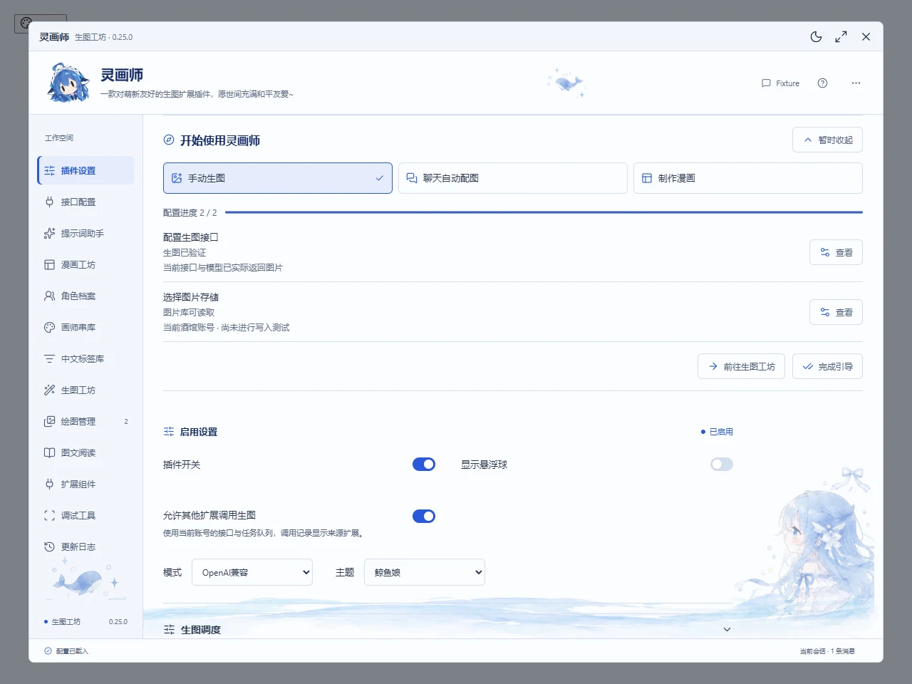

# 从安装到第一张图

[教程目录](README.md) · [下一篇：提示词助手](assistant.md)

> 本文包含截至 2026-10-23 的待发布界面。当前 GitHub 安装版的基础步骤见 [现行新手教程](../quickstart.md)，版本差异见 [适用范围](README.md)。

## 1. 安装并找到入口

在酒馆「扩展 → 安装扩展」中填写官方仓库：

```text
https://github.com/ibome/ai-brush-hug-st
```

安装完成后刷新酒馆，在扩展设置中打开「灵画师」。人物悬浮球也可以打开菜单，再点击「设置」。手机顶部功能栏可左右滑动，电脑左侧导航可独立滚动。

待发布版第一次使用会显示三种目标：手动生图、聊天自动配图、制作漫画。先选「手动生图」，逐项核对图片接口和存储。可以暂时收起，之后点击顶部问号重新查看。



图中是使用固定演示数据的验证环境；请以自己界面的状态为准。引导不会替你提交计费测试。

## 2. 选图片服务

打开「插件设置」，选择已有服务，再去「接口配置」：

| 手里有什么 | 选择模式 | 先准备什么 |
| --- | --- | --- |
| NovelAI 官方或插件已适配的第三方生图 Key | NovelAI | Key、对应服务支持的模型 |
| OpenAI 格式图片服务 | OpenAI 兼容 | 地址、Key、图片模型 |
| 自己的 ComfyUI | ComfyUI | 服务地址、API 工作流、参数节点映射 |
| 开启 API 的 Stable Diffusion WebUI | SDWebUI | 服务地址及服务要求的认证 |

OpenAI 兼容地址可填写根地址、带或不带 `/v1`，末尾 `/` 也可保留。图片模型和聊天模型不同；列表里能看到某个模型，不代表它能生图。

OpenAI 兼容模式的模型名包含 `nai-diffusion` 时，会提供独立负面提示词。普通 OpenAI 图片模型按该服务支持的参数提交，不假定支持 NovelAI 的全部高级能力。

Key 输入后等待「秘钥已保存」再刷新。眼睛按钮只切换显示与隐藏。显示为空时先检查是否处于原酒馆账号、原接口配置和原浏览器，再按 [接口教程](../interfaces.md) 核对凭据状态，不要反复新建相同配置。

## 3. 分清三种“保存”

| 名称 | 保存什么 | 什么时候用 |
| --- | --- | --- |
| 命名接口 | 某个服务的连接信息与凭据引用 | 在不同图片服务之间切换 |
| 参数预设 | 模型、尺寸、提示词等生成参数；可选关联接口 | 保存常用绘图配方 |
| 助手方案 | 文字分析、输出格式、上下文、任务规则等助手配置 | 在日常配图、人物特写等文字工作方式间切换 |

改了当前输入，不等于已更新命名接口或预设。需要更新已有条目时点击对应保存；需要保留原版时使用「另存为」。内置助手方案主要调整构图等常用选项，完整自建方案可能包含模型、预设来源和自动化开关，载入前先看摘要。

## 4. 选图片存储

在「插件设置 → 图片存储」选择：

| 位置 | 适合谁 | 换设备时 |
| --- | --- | --- |
| 浏览器 | 先快速试用，主要在一个浏览器绘图 | 原图不会自动过去，需要迁移或备份 |
| 酒馆服务器 | 希望同账号在手机和电脑读取作品 | 已保存的账号作品可读取，普通存图无需额外组件 |

切换选项不会搬走旧作品。「酒馆服务器」指酒馆运行设备的账号目录；使用远程酒馆时，它不是手机相册。TauriTavern 的对应数据位于客户端本机，详见 [宿主说明](../tauritavern.md)。

## 5. 先生成一张简单图片

在「接口配置」测试连接并选择图片模型，再进入「生图工坊」。第一张先用文生图、单张和较小预设尺寸，不叠加参考图、Vibe 或复杂角色。

正向示例：

```text
1girl, adult woman, white dress, garden, morning light,
gentle smile, anime illustration
```

支持独立负面词时可填：

```text
low quality, blurry, text, watermark
```

点击「生成图像」。等待区显示当前主题小人和真实任务阶段；只有接口实际提供进度时才显示百分比。完成后到「绘图管理」打开原图，核对作品确实保存。

状态的含义不同：

| 状态 | 证明了什么 |
| --- | --- |
| 已配置 | 必填内容已填写 |
| 连接通过 | 对应连接检查得到可用响应 |
| 生图权限已验证 | 该组合曾成功返回生成结果 |

实际绘图可能消耗服务额度。连接检查和模型列表不能代替一次真实生成成功。

## 6. 保存配方，再尝试聊天配图

参数可用后点击参数预设「另存为」，取名如「花园插画」。下次选择条目并载入；想绑定固定服务，可在保存时关联命名接口。

聊天标签示例：

```text
她在花园中停下脚步。
image###1girl, adult woman, garden, morning light, anime illustration###
```

需要先在角色设定或酒馆预设中约定输出格式，插件不会自动替文字模型加上这段要求。新安装默认开启自动生图和聊天显示，默认关闭生成前确认；旧用户保留已保存选择。自动处理只针对新完成的角色回复，旧消息可点「给这条配图」。

希望先看清每次提交内容，可主动开启「生成前确认提示词」。没有标签时，按 [助手教程](assistant.md) 先准备智能配图草稿。

## 出错时停在哪一步

| 看到的问题 | 下一步 |
| --- | --- |
| Key 或模型提示无效 | 返回当前接口配置，核对服务与精确模型名 |
| 连不上接口 | 检查当前功能的网络路线，运行对应网络检测 |
| 已有图片但保存失败 | 打开任务记录，优先继续取图或保存 |
| 提交结果待核对 | 先看上游记录，确认后再决定是否重新生成 |
| 找不到本文的新入口 | 核对版本；待发布功能尚未包含在当前 GitHub 安装版 |

详细处理见 [草稿、图片与备份](recovery-export.md) 和 [手机使用与可选组件](mobile-components.md)。
