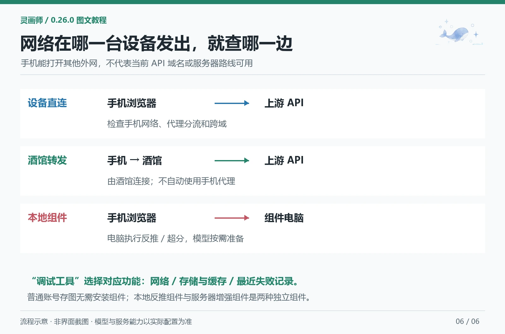

# 手机使用与可选组件

[教程目录](README.md) · [助手连接设置](assistant.md) · [恢复与备份](recovery-export.md)

> 适用于 0.26.0。调试参考见 [调试工具](../debug-tools.md)，服务器组件见 [扩展组件](../components.md)。

## 1. 手机界面怎么操作

顶部功能栏可左右滑动，切换功能保留导航位置。进入较长页面后记住对应滚动位置，主要操作在页面底部就近显示。常用设置隐藏暂时不需要的高级项目，点击标题或切换完整设置可以继续编辑，原值仍生效。

漫画预览在「编辑 / 预览」之间切换，气泡仅选中时显示移动、宽度手柄。需要详细位置和样式时再展开，避免控件遮住画面。

部分 iOS 浏览器此前存在提示词解析白屏和移动布局问题，本版已做兼容修复。若仍遇到同类情况，记录版本、设备与复现步骤，不要删除图库；自动化检查不能代替每种真机环境验证。

## 2. 手机代理正常，为什么独立 API 仍失败

| 路线 | 上游请求从哪里发出 | 应检查哪边网络 |
| --- | --- | --- |
| 图片接口/独立 API 设备直连 | 手机浏览器 | 手机代理分流、DNS、TLS、跨域、页面安全策略 |
| 提示词助手跟随酒馆 | 酒馆运行设备 | 服务器或本机酒馆的上游连接 |
| 独立 API 酒馆转发 | 酒馆运行设备，使用独立地址和 Key | 酒馆到上游的网络与宿主支持 |
| 手机连接本地反推组件 | 组件主机执行模型，手机访问组件 | 手机到组件地址的可达性与认证 |

能打开其他外网，不代表某个 API 域名已经走代理。HTTP 401 通常说明对应请求得到了响应，但不代表 Key 有效；不透明响应无法证明跨域和鉴权通过。

设备直连失败而跟随酒馆可用，可以按实际部署试用独立 API 的「酒馆转发」。它保持助手独立模型和连接，不修改聊天正文配置。远程酒馆不会自动使用手机代理。

手机中的 `localhost`、`127.0.0.1` 指手机本身。连接电脑组件要填写电脑实际可访问地址。HTTPS 酒馆访问 HTTP 组件可能被浏览器拦截，需按部署提供 HTTPS 入口。

## 3. 检测时选对功能

进入侧边栏「调试工具」：

1. 独立文字 API 报错，选择「提示词助手 · 独立 API」，也可从助手页直接点「检测助手网络」。
2. NovelAI 生图连接报错，选择 NovelAI；其他图片接口选择对应模式。
3. 保存失败或生图卡顿，运行「检测存储与缓存」，再看最近失败阶段。
4. 复制或下载脱敏日志，附上插件版本、设备浏览器与复现步骤反馈。

检测为只读接口访问与独立小数据存储测试，不提交文字或图片生成。需要认证的检查会把凭据发送给当前所选服务，但导出的诊断不含 Key、认证头、聊天正文和图片内容，日志不自动发送。

存储检测约 1 KB 试写不是整批大图压力测试；浏览器站点配额也不是服务器磁盘余量。不能精确诊断的 DNS、TLS、代理和跨域问题会保留不确定性，不伪装成已定位。

反馈入口：[GitHub Issues](https://github.com/ibome/ai-brush-hug-st/issues)。交流QQ群：**1076122953**。截图和手动粘贴的错误内容仍需自行遮住私人信息。

## 4. 本地反推与超分是什么

这是独立可选的 `linghuashi-local-tools` 组件，不是普通存图必装项。

| 功能 | 输入 | 输出 | 运行位置 |
| --- | --- | --- | --- |
| WD 标签反推 | 上传图片或图库带图 | 英文标签，可编辑后复制/应用 | 安装组件的电脑 |
| FSRCNN 超分 | 原图、2×或4×倍率 | 放大预览，可保存为新版本或下载 | 安装组件的电脑 |

手机只负责操作和展示，不会因为安装前端插件就把较重模型装到手机。反推不保证识别所有细节；FSRCNN 放大也不等于重新绘制或保证补全真实细节。

普通酒馆账号存图使用内置能力即可；跨设备任务等属于另一项可选服务器增强组件。两种组件不要混淆。

## 5. 四步安装向导

在「扩展组件 → 本地反推与超分」打开安装向导：

1. **安装环境**：选组件主机系统和运行位置，在该电脑安装包要求的 Python 与依赖。
2. **启动组件**：在组件电脑执行向导提供的命令，保持服务运行。
3. **连接验证**：填写组件地址与访问令牌，再保存并测试。
4. **准备模型**：按需下载所选模型，等待校验与就绪。

界面不会自动替用户安装依赖。组件包、Python 依赖和模型权重分开准备；可从 [0.26.0 发行页](https://github.com/ibome/ai-brush-hug-st/releases/tag/v0.26.0) 下载 `linghuashi-local-tools-v0.26.0.zip`，也可使用组件页的下载入口。

填写自己的完整 HTTP/HTTPS 地址。服务启动、令牌通过、推理依赖和模型就绪分别检查，不把“端口通了”当作“模型能运行”。

配套环境检查脚本可生成 `environment-diagnostics.json`，导入向导查看 Python、依赖、写权限、空间和端口状态。组件诊断不会包含令牌、完整路径、图片或提示词。

## 6. 使用时先预览，再写回

反推：从图库带图或上传 → 检查标签 → 手动编辑 → 复制或应用。不会自动替换所有全局提示词。

超分：选择原图和倍率 → 等待任务 → 查看放大预览 → 保存为新版本或独立下载。原图保留，失败不应通过反复提交图片生图接口来解决。

电脑资源有限时先试小图和 2×，避免同时处理多份大图。手机访问远程组件时，分别核对酒馆、组件和下载文件所在位置。
