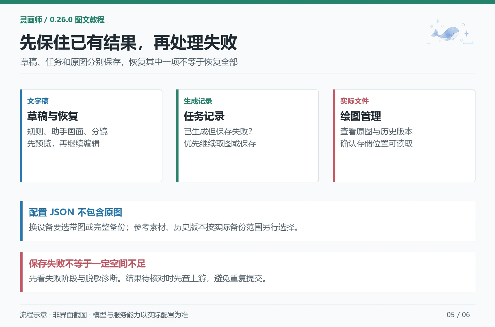

# 草稿、图片与备份

[教程目录](README.md) · [漫画工坊](comic.md) · [手机与组件](mobile-components.md)

> 适用于 0.26.0。基础参考见 [绘图管理与任务](../gallery-tasks.md) 和 [备份与恢复](../backup.md)。

## 1. 草稿不等于图片

| 数据 | 内容 | 常用入口 |
| --- | --- | --- |
| 当前工作稿 | 尚未采用或保存的规则、画面、分镜 | 原编辑页 |
| 草稿历史/恢复记录 | 较早画面、失败回复、待采用分镜等 | 插件设置 → 草稿与恢复 |
| 生图任务 | 提交状态、请求计划和可恢复结果 | 生图工坊 → 任务记录 |
| 图片作品 | 原图、缩略图、参数、版本和收藏 | 绘图管理 |
| 配置备份 | 选择的设置、档案、项目等 | 备份与恢复 |
| 完整/带图备份 | 配置及选定图片等实际文件 | 备份与恢复或漫画带图备份 |

恢复文字稿不会自动恢复图片；看到任务记录也不代表服务器已经返回图片。

## 2. 找回没写完的内容

打开「插件设置 → 草稿与恢复」，查看任务提示词草稿、助手当前/历史画面、失败回复、漫画待采用分镜及编辑记录。

操作建议：

1. 展开内容预览，确认是需要的那份。
2. 点击「继续编辑」回原入口，或恢复导入的待恢复条目。
3. 核对后明确保存或采用；恢复不会自动调用模型、生图或执行旧任务。
4. 需要换设备时勾选导出草稿，或在适用的个人备份中选择草稿数据。

导入先进入待恢复列表，不直接覆盖当前稿。恢复会保留原工作内容，漫画恢复为副本。

部分恢复记录只在本设备当前账号保留，清除站点数据会丢失。本版提供显式草稿包与备份选项，不能仅因为配置在酒馆中保存，就认定所有未保存草稿已经跨设备同步。

## 3. 生图失败后按任务状态处理

| 当前状态 | 应做什么 | 不应直接做什么 |
| --- | --- | --- |
| 未提交、暂停 | 核对参数和接口后手动继续 | 不必新建同一请求 |
| 结果已保留、保存失败 | 继续取图或保存现有结果 | 不必再花额度重画 |
| ComfyUI 已有任务编号 | 按记录继续查询、读取结果 | 不应丢弃编号反复提交 |
| 结果待核对 | 先查上游任务或用量记录 | 不要把状态不明当作确定失败 |
| 已完成 | 查看对应图库与存储位置 | 不因暂时未刷新就再画一次 |

没有增强组件时，任务和已接收响应主要保留在原浏览器。清理站点数据、换浏览器或关闭未完成保存的页面前，应先完成任务并备份。增强组件可提供跨设备任务记录，但不保证同步生图请求在网页关闭后必定完成。

取消可能只停止本地等待，远端仍可能执行；不要把取消按钮理解为服务方一定退款或中止。

## 4. 只修改当前图片

点击聊天图片或绘图管理中的缩略图，选择「编辑这张图」。修改本图提示词、角色快照、尺寸等，再「重绘为新版本」。

| 操作 | 对全局参数的影响 | 对原图的影响 |
| --- | --- | --- |
| 编辑这张图 | 使用独立编辑稿 | 重画新增版本 |
| 再画一张 | 沿用本图参数重新采样 | 旧图保留 |
| 切换历史版本 | 不修改全局参数 | 改当前显示版本 |
| 导入参数 | 回填来源模式的当前配置 | 不修改已保存原图 |
| 图生图/局部重绘 | 使用选中图为底图或蒙版素材 | 成功后新增版本 |

重画通常使用来源模式当前可用的接口凭据，不会从图片里“找回旧 Key”。聊天版本切换会显示等待状态，目标图显示前暂停该图操作，避免快速点击打开上一版。

编辑窗口有未保存内容时先处理窗口提示；不要通过连续点不同图片覆盖工作稿。

## 5. 在手机和电脑之间搬作品

| 保存位置 | 已保存原图在哪 | 其他设备能否直接读取 |
| --- | --- | --- |
| 浏览器 | 当前站点、当前浏览器的 IndexedDB | 不能自动读取 |
| 酒馆服务器 | 当前酒馆账号的图片和文件目录 | 同账号且服务器可访问时可以 |
| TauriTavern 对应账号存图 | 该客户端本机目录 | 不等于远程同步 |

切换保存位置不迁移旧图。使用「迁移浏览器图片」时保留原作品，迁移后核对数量和历史版本；也可以导出图片备份，再在目标设备导入。

大型酒馆图库会先用本设备参数索引展示，再分批核对旧记录。剩余核对数量不是丢图数量。多设备编辑后可手动重新核对；读取暂时失败保留旧记录，索引不能替代原图。

## 6. 图文阅读与导出

打开目标聊天，进入「图文阅读」，设置起止楼层并点击「读取图文」。

阅读使用当前聊天、当前回复分支、当前选中版本；缺失图片显示占位，不会自动重画。

阅读设置可调整字号、行距、图片宽度和用户消息显示。先用缩略图浏览，点击再看原图。

| 导出方式 | 包含什么 | 打开方法 |
| --- | --- | --- |
| 单文件 HTML | 选定正文、原图、阅读设置和主题颜色 | 用浏览器离线打开 |
| Markdown ZIP | `阅读.md`、`images/`、图文清单 | 解压并保持相对目录结构 |

导出前后会核对正文、分支和图片版本，原文变化时需重新读取。导出不会调用文字或图片接口；不会额外带上 Key 和接口配置，但所选正文与原图本身仍需分享前检查。

每次最多 3000 条消息、400 万字符、600 处配图，正文和原图合计不超过 64 MB，单图不超过 20 MB。手机导出失败时先缩小楼层范围。

## 7. 选对备份

| 目标 | 建议 |
| --- | --- |
| 分享画风或提示词 | 导出对应库/方案，检查自填正文 |
| 迁移规则、档案和预设 | 个人配置备份，核对所选范围 |
| 连作品一起搬设备 | 同时选择原图与所需参考素材 |
| 只搬一个漫画章节 | `.comic.zip`，保留当前配图 |
| 搬整套漫画 | 系列带图包；旧版本和参考素材另做完整备份 |
| 连 Key 一起备份 | 使用支持的个人加密备份并妥善保管口令 |

普通参数、分享包和图片不应被当作 Key 备份。加密备份需要 HTTPS 或本机安全环境；普通 HTTP 受限时仍可做不带秘钥的适用备份。

文件生成后到下载目录核对，再在目标设备导入并检查。教程不把“下载按钮已点击”当作备份完成。

## 8. 遇到“请检查图片存储空间”

先看失败阶段，而不是直接清缓存。可能失败在生成、下载、图片处理、保存响应、数据库、上传限制或账号权限。

打开「调试工具」检测存储与缓存，查看最近失败记录。若有保留响应，先继续保存。小数据试写成功只说明该次试写通过，大图仍可能受内存、配额或服务器限制。排错步骤见 [手机与调试](mobile-components.md)。
